  

  Hey, I'm Abishek. I study computer science at VIT Vellore and like building things end to end.

🥈 Runner-up · SEMICON India National Hackathon 2026

  
  
  
  
  
  

  <a href="https://www.linkedin.com/in/abishek-sundararaman-8a09b836b/">LinkedIn</a> ·
  <a href="https://github.com/abishek1123?tab=repositories">Projects</a>

